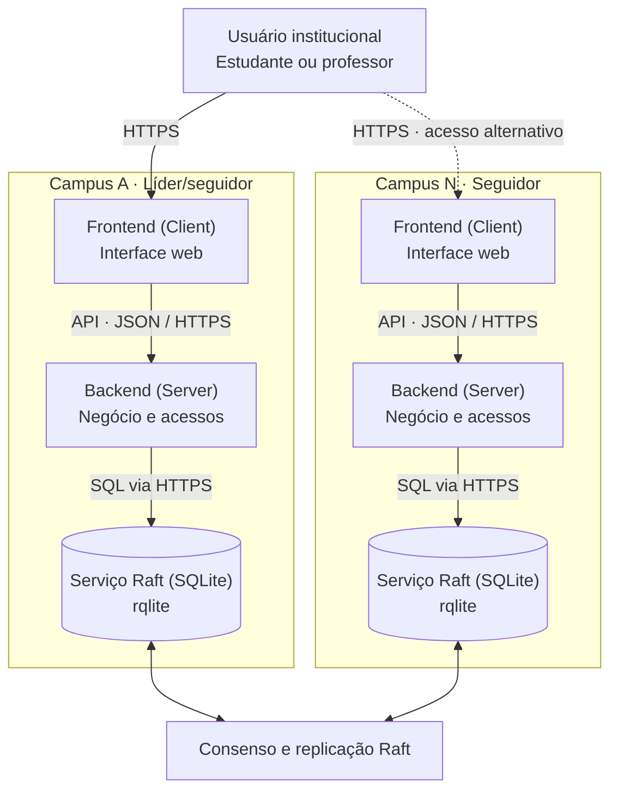
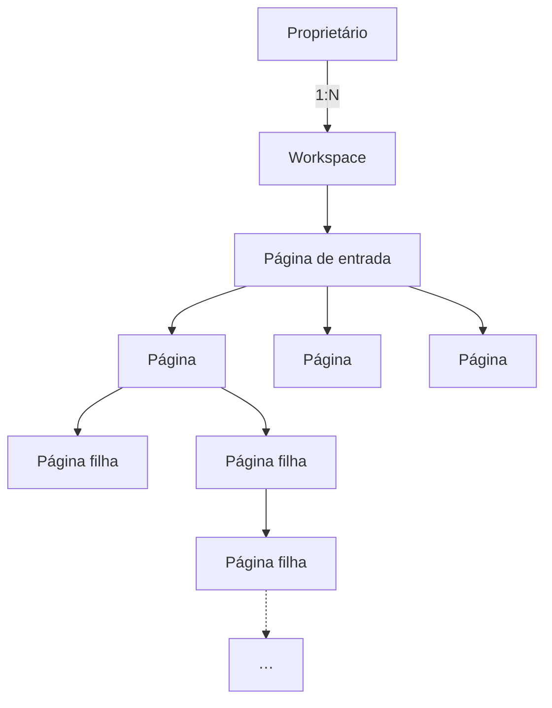
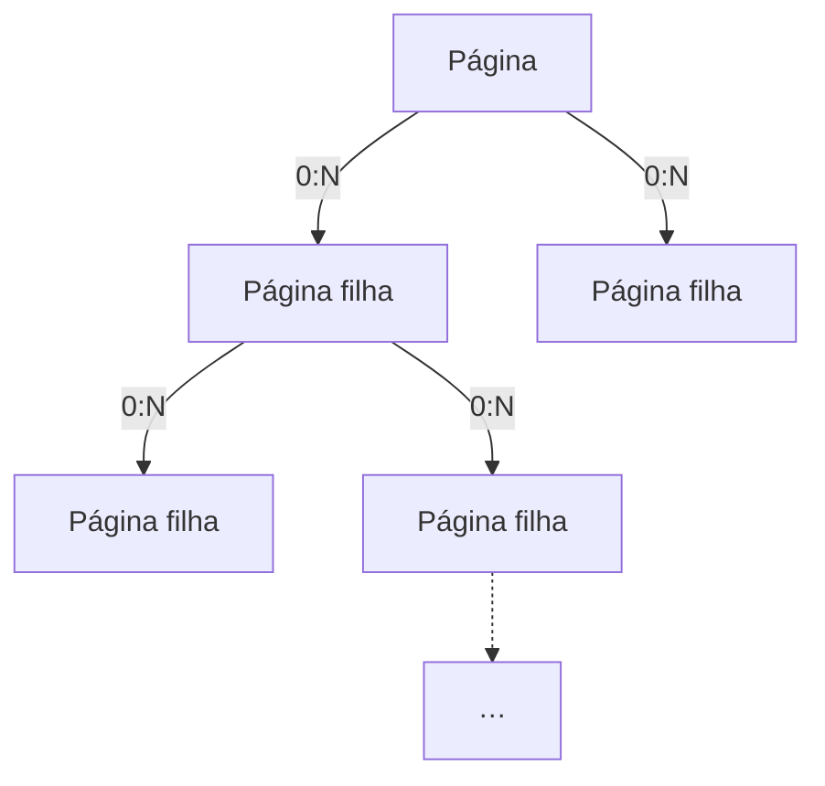

<!-- _header: Bacharelado em Ciência da Computação | Instituto Federal Catarinense Campus Blumenau -->
<!-- _class: cover -->

### **ATOM**: DESENVOLVIMENTO DE UMA ARQUITETURA DISTRIBUÍDA TOLERANTE A FALTAS COMO BASE DO DESENVOLVIMENTO DE SOFTWARE NA FÁBRICA DE SOFTWARE DO IFC CAMPUS BLUMENAU

<!-- _footer: Helder Martins Dos Santos Orientador: Dr. Hylson Vescovi Netto -->

---

# Sumário

1. Introdução
2. Desenvolvimento
3. Considerações finais
4. Referências

<!-- Fonte: Slides___Cub_s.pdf, slide 2. -->

---

# Introdução

- **Contexto:** instituições de ensino dependem de sistemas digitais e serviços em nuvem. [6]
- **Problema:** a centralização cria pontos únicos de falha e dependência de conectividade. [2]
- **Desafio:** manter a integridade dos dados e a continuidade dos serviços em ambientes multicampi.
- **Proposta:** a arquitetura **ATOM**, com Raft e rqlite, aplicada ao **Cub's** como prova de conceito. [1, 8]

<!-- Fontes: Slides___Cub_s.pdf, slide 3; TCC/document/capitulos/cap_1.tex. A sigla da arquitetura foi padronizada para ATOM conforme solicitado. -->

---

# Objetivo geral

Desenvolver e validar uma <mark>arquitetura distribuída, multi-tenant e tolerante a faltas</mark>, fundamentada no protocolo de consenso **Raft** e implementada sobre o **rqlite**, para preservar a integridade dos dados e apoiar a continuidade operacional em instituições de ensino multicampi. [1, 8]

<!-- Fontes: Slides___Cub_s.pdf, slide 4; TCC/document/capitulos/cap_2.tex. -->

---

# Objetivos específicos

- Projetar a infraestrutura distribuída da **ATOM** e reduzir pontos únicos de falha.
- Modelar o isolamento lógico de cada campus por meio de **Espaços de trabalho**.
- Entregar um artefato, utilizando-o como prova de conceito de alta disponibilidade no acesso à informação.
- Avaliar a resiliência em cenários controlados de falha de nós e partições de rede.
- Integrar fluxos de gestão de tarefas e organização do conhecimento fundamentados na **Engenharia de Software**.

<!-- Fontes: Slides___Cub_s.pdf, slide 5; TCC/document/capitulos/cap_2.tex e cap_5.tex. Objetivos e avaliações propostos, sem alegação de validação concluída. -->

---

# Justificativa

- A dependência de um servidor central pode interromper as atividades de vários campi.
- A instituição precisa de <mark>controle sobre seus dados e autonomia de infraestrutura</mark>. [9]
- A fragmentação das ferramentas de gestão dificulta a organização do trabalho na **Fábrica de Software**. [11]

<!-- Fontes: Slides___Cub_s.pdf, slide 6; TCC/document/capitulos/cap_3.tex. -->

---

<!-- _class: overview -->

# Desenvolvimento

## Fundamentação

<ul>
  <li>Sis&shy;te&shy;mas dis&shy;tri&shy;bu&shy;í&shy;dos [5]</li>
  <li>Te&shy;o&shy;re&shy;ma CAP [2]</li>
  <li>Con&shy;sen&shy;so Raft [8]</li>
  <li>Per&shy;sis&shy;tên&shy;cia na bor&shy;da [1]</li>
  <li>Qua&shy;li&shy;da&shy;de de software [3]</li>
</ul>

## Arquitetura ATOM

<ul>
  <li>Iso&shy;la&shy;men&shy;to por work&shy;space</li>
  <li>Re&shy;pli&shy;ca&shy;ção com rqlite</li>
  <li>Mo&shy;de&shy;lo PageTree</li>
  <li>Atri&shy;bu&shy;tos di&shy;nâ&shy;mi&shy;cos (EAV)</li>
  <li>Por&shy;ta&shy;bi&shy;li&shy;da&shy;de [9]</li>
</ul>

## Implementação

<ul>
  <li>Pro&shy;va de con&shy;cei&shy;to: Cub's</li>
  <li>Pá&shy;gi&shy;nas re&shy;cur&shy;si&shy;vas</li>
  <li>Blo&shy;cos ti&shy;pa&shy;dos</li>
  <li>Ges&shy;tão de ta&shy;re&shy;fas</li>
  <li>Ex&shy;pe&shy;ri&shy;men&shy;tos de fa&shy;lha</li>
</ul>

<!-- Fontes: Slides___Cub_s.pdf, slide 7; TCC/document/capitulos/cap_4.tex, cap_5.tex e cap_6.tex. -->

---

<!-- _class: diagram-full raft-consensus with-source -->

# Consenso Raft

<iframe class="raftscope-frame" src="./static/raftscope/index.html" title="RaftScope — simulação de eleição e replicação em cinco nós"></iframe>

O líder replica entradas do log aos seguidores com <strong>AppendEntries</strong>. Com cinco nós votantes, pode confirmar uma entrada do termo atual após replicá-la em <mark>três nós, contando o líder</mark>.

<!-- _footer: Diego Ongaro e John Ousterhout (2014) · [Artigo original, seções 5.3 e 5.4](https://raft.github.io/raft.pdf) · [RaftScope original](https://raft.github.io/raftscope/index.html) -->

---

<!-- _class: raft-math -->

# Quórum no Raft

Um **cluster** é um grupo de nós que mantêm cópias do banco de dados.

**Quórum** é o mínimo de nós que precisam concordar para salvar dados. No Raft, é mais da metade.

Em um cluster de **3 nós**, bastam **2** para salvar dados. Por isso, o cluster aguenta **1 falha**. [17]

---

<!-- _class: raft-math -->

# Dimensionamento do cluster

## Número mínimo de nós

$$
\text{Nós mínimos} = 2 \times \text{Falhas} + 1
$$

**Simplificando:**

$$
N = 2F + 1
$$

## Limite de falhas

$$
\text{Falhas} = \left\lfloor \frac{\text{Nós} - 1}{2} \right\rfloor
$$

**Simplificando:**

$$
F = \left\lfloor \frac{N - 1}{2} \right\rfloor
$$

---

<!-- _class: with-source -->

# Arquitetura ATOM
## Conceitos

- **Workspaces:** delimita o contexto de acesso e o isolamento lógico de cada campus.
- **Página de entrada:** ponto de acesso à hierarquia de páginas do workspace.
- **PageTree:** organiza páginas em uma estrutura recursiva e homogênea.
- **Persistência:** o rqlite replica os dados por meio do consenso Raft. [1, 8]
- **Continuidade:** as escritas dependem de <mark>quórum entre os nós do cluster</mark>; um nó isolado não confirma novas escritas.

<!-- _footer: Philip O’Toole (2014) · [rqlite](https://philipotoole.com/replicating-sqlite-using-raft-consensus/) · Diego Ongaro e John Ousterhout (2014) · [Raft](https://raft.github.io/raft.pdf) -->

<!-- Fontes: Slides___Cub_s.pdf, slide 8; TCC/document/capitulos/cap_1.tex, cap_4.tex e cap_6.tex. A condição de quórum substitui a afirmação de autonomia irrestrita do PDF. -->

---

<!-- _class: diagram-full architecture-c4 with-source -->

# Arquitetura distribuída do ATOM

Se o nó acessado ficar indisponível, o usuário recorre a outro. Escritas exigem quórum no cluster.

<!-- _footer: Philip O’Toole (2014) · [Replicating SQLite using Raft Consensus](https://philipotoole.com/replicating-sqlite-using-raft-consensus/) -->

<!-- Diagrama de contêineres simplificado conforme a referência fornecida. Os dois campi são um recorte do cluster; a ligação Raft indica o protocolo, sem representar um serviço central adicional. O acesso alternativo não pressupõe redirecionamento automático. -->

---

# Arquitetura do Artefato
## Contexto multi-tenant do ATOM

---

<!-- _class: diagram-full -->

---

# Modelo PageTree
## Conceitos

- **Página:** unidade estrutural comum para organizar projetos, tarefas e documentação.
- **Composição:** cada página pode conter blocos tipados e outras páginas.
- **Recursão:** uma página filha segue <mark>o mesmo modelo da página que a contém</mark>.
- **Contexto:** raiz e subpágina indicam posições na árvore; o conteúdo varia conforme os blocos e metadados.

<!-- Fontes: Slides___Cub_s.pdf, slide 10; TCC/document/capitulos/cap_6.tex, seção Descrição da ferramenta. -->

---

<!-- _class: diagram-full pagetree-zoom -->

# PageTree: recursão de páginas

Cada página pode conter <mark>zero ou mais páginas</mark>, repetindo a mesma estrutura.

<!-- Fontes: TCC/document/capitulos/cap_6.tex; modelo atual em cubs-backend/src/db/schemas/PageEdge.schema.ts. Zoom limitado à relação página–página. 0:N representa a quantidade de filhas por página; uma página pode ser uma folha. -->

---

# Extensibilidade do artefato
## Plano para a Fábrica de Software

- **Base reutilizável:** usar o rqlite como persistência SQL replicada para novos módulos e projetos da Fábrica.
- **EAV (Entidade–Atributo–Valor):** definir campos por metadados, sem criar uma coluna SQL para cada atributo.
- **Relações complexas:** vincular projetos, tarefas e pessoas com tabelas associativas, chaves e consultas SQL. [16]
- **Evolução controlada:** validar tipos e contexto multi-tenant no backend, com índices e testes das consultas.

<!-- Fontes: proposta EAV e PageTree em TCC/document/capitulos/cap_6.tex; https://sqlite.org/foreignkeys.html; https://rqlite.io/docs/features/. EAV e as regras de domínio pertencem ao modelo da aplicação; rqlite fornece persistência e replicação. Relações N:N usam tabelas associativas, e a imposição de chaves estrangeiras deve ser habilitada em todos os nós. Novos atributos não exigem uma coluna por atributo, mas alterações do modelo base ainda podem exigir migrações. -->

---

# Proteção de dados
## TLS e LGPD

O rqlite oferece **criptografia em trânsito** na API (HTTPS) e entre os nós. Com mTLS habilitado, ambos os lados validam os certificados no handshake. [15]

A leitura direta do SQLite passa pelas **permissões do sistema operacional**. A criptografia em repouso fica a cargo da infraestrutura que protege volumes e backups. [21]

O ATOM prevê medidas técnicas e administrativas desde a concepção, conforme o **art. 46 da LGPD**. [18]

<!-- A leitura direta deve usar modo somente leitura. As alterações devem passar pela API. O mTLS pode ser configurado na API e entre os nós. -->

---

# Controle de acesso
## Plano de autorização e menor privilégio

| Camada | Controle de permissões |
| --- | --- |
| **Backend do ATOM** | Perfis e autorizações por workspace, página e ação. |
| **rqlite** | Permissões por conta na API (`query` e `execute`). [15] |
| **MySQL / PostgreSQL** | Privilégios SQL por objeto, com `GRANT` e `REVOKE`. [19, 20] |

O rqlite permite contas de <mark>somente leitura</mark>. O backend do ATOM restringe os dados visíveis a cada usuário. [15]

<!-- Fontes: https://rqlite.io/docs/guides/security/; https://dev.mysql.com/doc/refman/8.4/en/grant.html; https://www.postgresql.org/docs/current/ddl-priv.html; https://sqlite.org/omitted.html. O objetivo de controle de acesso é comum, mas os mecanismos são distintos. SQLite não implementa GRANT/REVOKE; as permissões HTTP do rqlite não restringem por workspace ou página. A proposta exige autorização no backend, credenciais técnicas separadas e registro de operações relevantes. -->

---

<!-- _class: conclusions -->

# Considerações até o momento

- Revisão bibliográfica sistemática consolidada e fundamentação estruturada. [12]
- Arquitetura **ATOM** definida e **PageTree** formalizado e validado conceitualmente.
- Protótipo funcional do **Cub's** construído com práticas ágeis. [11]
- Cenários de teste e métricas de injeção de falhas mapeados. [13, 14]

## Próximas etapas

- Concluir o desenvolvimento e a integração.
- Executar experimentos controlados de isolamento de rede.
- Coletar, tabular e comparar os resultados. [12]
- Estudar a viabilidade da **ATOM** em sistemas dos campi, como **SIGAA** e **Moodle**.

<!-- Fonte: referência visual fornecida pelo autor para as considerações até o momento. SIGAA e Moodle foram acrescentados por solicitação como estudo futuro de viabilidade; não se afirma integração já realizada nem substituição direta de seus bancos de dados. A validação conceitual do PageTree não equivale à conclusão dos experimentos de resiliência multicampi. -->

---

<!-- _class: references -->

# Referências I

[1] AHLSTRÖM, K. *Adapting SQLite to the Distributed Edge: A Comparative Study of Different Adaptations*. Aalto University, 2025.

[2] BREWER, E. A. *Towards robust distributed systems*. PODC, 2000. DOI: 10.1145/343477.343502.

[3] ISO25000. *ISO/IEC 25010*. Disponível em: https://iso25000.com/index.php/en/iso-25000-standards/iso-25010. Acesso registrado no TCC: 25 maio 2026.

[4] MARTINELLI, F. B. *Gestão da Qualidade Total*. Curitiba: IESDE, 2009.

[5] MAZIERO, C. A. *Sistemas Operacionais: Conceitos e Mecanismos*. Curitiba: DINF/UFPR, 2019.

[6] MEZNI, H.; ARIDHI, S.; HADJALI, A. *The uncertain cloud: State of the art and research challenges*. International Journal of Approximate Reasoning, v. 103, p. 139–151, 2018.

[7] SILVEIRA NETO, M. V.; MALUCELLI, A.; REINEHR, S. *Agile Software Architecture: Perceptions on Quality and Architectural Technical Debt Management*. SBCARS, 2025.

<!-- Fonte: TCC/document/pos_textual/referencias.bib; numeração mantida conforme Slides___Cub_s.pdf. -->

---

<!-- _class: references -->

# Referências II

[8] ONGARO, D.; OUSTERHOUT, J. *In search of an understandable consensus algorithm*. USENIX ATC, p. 305–320, 2014. https://raft.github.io/raft.pdf.

[9] RÓŻAŃSKA, M.; KRITIKOS, K. *Good Bye Vendor Lock-in: Getting your Cloud Applications Multi-Cloud Ready!*. UCC Companion, 2019. DOI: 10.1145/3368235.3370267.

[10] STERN, J.; MUINDI, M. *ReSQLite: Replicating SQLite using Raft*. Stanford University, 2024. https://github.com/jervisfm/resqlite.

[11] SUTHERLAND, J. *Scrum: a arte de fazer o dobro do trabalho na metade do tempo*. São Paulo: LeYa, 2014.

[12] WAZLAWICK, R. S. *Metodologia de pesquisa para ciência da computação*. 3. ed. Rio de Janeiro: LTC, 2021.

[13] WILCOX, J. R. et al. *Verdi: A framework for implementing and verifying distributed systems*. PLDI, 2015.

[14] ZHAO, W. et al. *A lightweight fault tolerance framework for Web services*. ARES, 2009.

<!-- Fonte: TCC/document/pos_textual/referencias.bib; numeração mantida conforme Slides___Cub_s.pdf. -->

---

<!-- _class: references -->

# Referências III

[15] RQLITE. [*Security*](https://rqlite.io/docs/guides/security/). Documentação de TLS, autenticação e autorização.

[16] SQLITE. [*SQLite Foreign Key Support*](https://sqlite.org/foreignkeys.html). Restrições de integridade e relações entre tabelas.

[17] RQLITE. [*General guidelines*](https://rqlite.io/docs/clustering/general-guidelines/). Quórum e tolerância a falhas.

[18] BRASIL. [*Lei nº 13.709/2018 — Lei Geral de Proteção de Dados Pessoais*](https://www2.camara.leg.br/legin/fed/lei/2018/lei-13709-14-agosto-2018-787077-normaatualizada-pl.html). Art. 46. Texto atualizado, Câmara dos Deputados.

[19] MYSQL. [*GRANT Statement*](https://dev.mysql.com/doc/refman/8.4/en/grant.html). MySQL 8.4 Reference Manual.

[20] POSTGRESQL. [*Privileges*](https://www.postgresql.org/docs/current/ddl-priv.html). Documentação oficial.

[21] RQLITE. [*Directly accessing SQLite*](https://rqlite.io/docs/guides/direct-access/). Acesso local ao arquivo e permissões do sistema operacional.

[22] O’TOOLE, Philip. [*Replicating SQLite using Raft Consensus*](https://philipotoole.com/replicating-sqlite-using-raft-consensus/). 2014.

<!-- Documentação consultada em 6 de novembro de 2026. -->

---

<!-- _class: cover -->

### **ATOM**: DESENVOLVIMENTO DE UMA ARQUITETURA DISTRIBUÍDA TOLERANTE A FALTAS COMO BASE DO DESENVOLVIMENTO DE SOFTWARE NA FÁBRICA DE SOFTWARE DO IFC CAMPUS BLUMENAU

<!-- _footer: Helder Martins Dos Santos Orientador: Dr. Hylson Vescovi Netto -->
